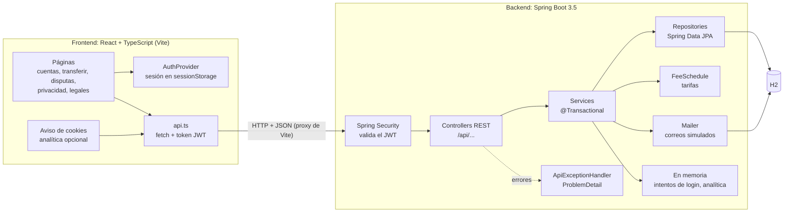
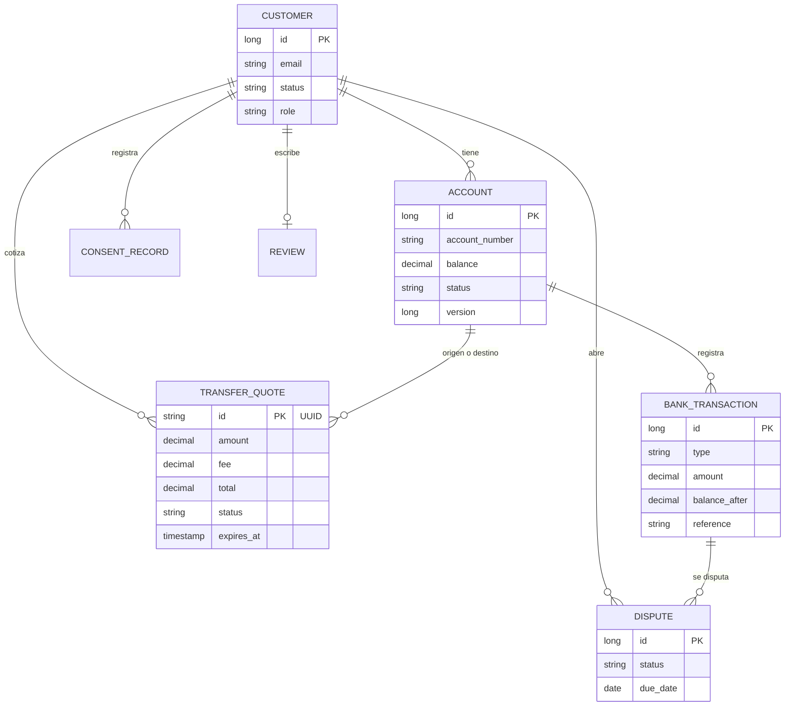
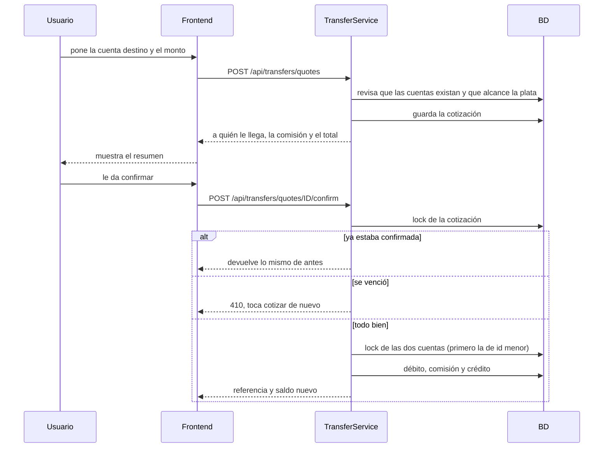

# Banco Gocomezbo

<p align="center">
  Banca en línea de práctica con Spring Boot y React. El banco es ficticio y no se maneja dinero real.
</p>

<p align="center">
  
  
  
  
  
  
  
</p>

## Contenido

- [Qué tiene](#qué-tiene)
- [Stack](#stack)
- [Cómo correrlo](#cómo-correrlo)
- [Variables de entorno](#variables-de-entorno)
- [Estructura](#estructura)
- [Rutas](#rutas)
- [Arquitectura](#arquitectura)
- [Pendientes](#pendientes)
- [Datos, licencia y aviso](#-datos-licencia-y-aviso)
- [Autor](#-autor)

## Qué tiene

- Registro, login con JWT y bloqueo después de 5 intentos fallidos
- Cuentas de ahorro y corriente, depósitos simulados y movimientos
- Transferencias en dos pasos: primero se cotiza (muestra comisión y total) y después se confirma
- Retracto de cuentas nuevas dentro de 5 días hábiles
- Disputas: las comisiones se devuelven automáticamente, las transferencias las revisa el admin
- Menores de edad necesitan autorización del tutor
- Consentimientos de publicidad y analítica (apagados por defecto) y link de baja
- Exportar y borrar los datos personales
- Reseñas solo de clientes con movimientos
- Páginas de términos, privacidad, cookies, devoluciones, aviso de IA, tarifas, datos de la empresa, licencias e integraciones

## Stack

| Parte | Tecnologías |
|-------|-------------|
| Backend | Java 17+, Spring Boot 3.5, Spring Web, Spring Data JPA, Bean Validation |
| Seguridad | Spring Security, JWT (HS256), BCrypt |
| Base de datos | H2 en archivo (pruebas en memoria) |
| Frontend | React 18, TypeScript, React Router, Vite |
| Pruebas | JUnit 5, MockMvc, AssertJ |

## Cómo correrlo

Requisitos: Java 17+ y Node 18+. Maven es opcional, `run.cmd` lo descarga si no está instalado.

Backend (puerto 8080):

```
cd backend
run.cmd          (o run.cmd test para las pruebas)
```

Frontend (puerto 5173):

```
cd frontend
npm install
npm run dev
```

Usuario admin: `admin@gocomezbo.demo` / `Admin123!`

Los correos no se envían de verdad, quedan guardados y se pueden ver en `/dev/correos` (ahí salen los links de autorización del tutor y de baja).

La base de datos queda en `backend/data/`. Si se borra esa carpeta arranca de cero.

## Variables de entorno

Son opcionales en desarrollo, si no se definen se usan valores de prueba.

| Variable | Para qué |
|----------|----------|
| `APP_JWT_SECRET` | Clave para firmar los tokens (mínimo 32 caracteres) |
| `APP_ADMIN_PASSWORD` | Contraseña del usuario admin que se crea al arrancar |

## Estructura

```bash
online-banking/
├── backend/
│   ├── pom.xml
│   ├── run.cmd / run.ps1
│   └── src/
│       ├── main/java/com/onlinebanking/
│       │   ├── account/        cuentas y movimientos
│       │   ├── transfer/       cotización y confirmación
│       │   ├── dispute/        disputas y devoluciones
│       │   ├── auth/           registro, login y JWT
│       │   ├── customer/
│       │   ├── consent/        consentimientos
│       │   ├── privacy/        exportar y borrar datos
│       │   ├── review/         reseñas
│       │   ├── publicinfo/     textos legales, tarifas, promesas
│       │   ├── notification/   correos simulados
│       │   ├── fees/
│       │   ├── analytics/
│       │   ├── admin/
│       │   ├── common/         errores, dinero, días hábiles
│       │   └── config/         seguridad y usuario admin
│       └── test/
└── frontend/
    └── src/
        ├── pages/
        ├── components/
        ├── api.ts
        └── auth.tsx
```

## Rutas

Frontend:

| Ruta | Qué hay |
|------|---------|
| `/` | Inicio, promesas con evidencia y tarifas |
| `/registro`, `/ingresar` | Crear cuenta e iniciar sesión |
| `/cuentas`, `/cuentas/:id` | Mis cuentas, movimientos, depósito, retracto |
| `/transferir` | Transferencia en dos pasos |
| `/disputas` | Mis disputas |
| `/privacidad` | Permisos, descargar y borrar datos |
| `/admin` | Disputas pendientes y boletín (solo admin) |
| `/legal/:doc` | Términos, privacidad, cookies, devoluciones, IA |
| `/dev/correos` | Correos simulados |

API (todo bajo `/api`):

| Método | Ruta | Qué hace |
|--------|------|----------|
| POST | `/auth/register`, `/auth/login` | Registro y login |
| GET, POST | `/accounts`, `/accounts/{id}/deposits` | Cuentas y depósito simulado |
| GET | `/accounts/{id}/transactions` | Movimientos |
| POST | `/accounts/{id}/retract`, `/accounts/{id}/close` | Retracto y cierre |
| POST | `/transfers/quotes`, `/transfers/quotes/{id}/confirm` | Cotizar y confirmar |
| POST | `/transactions/{id}/disputes` | Abrir una disputa |
| GET, PUT, POST | `/me`, `/me/consents/{tipo}`, `/me/export`, `/me/delete` | Perfil y privacidad |
| GET | `/public/fees`, `/public/legal/{doc}`, `/public/promises`... | Información pública |
| GET, POST | `/admin/disputes`, `/admin/newsletter` | Solo admin |

## Arquitectura

### Componentes



### Modelo de datos



### Cómo funciona una transferencia

Primero se pide una cotización y después se confirma. Si alguien le da dos veces a confirmar no pasa nada, y si se demora más de 2 minutos toca cotizar otra vez.



## Pendientes

- Los días hábiles no tienen en cuenta festivos
- El bloqueo de login está en memoria
- Los textos legales son de ejemplo

## 📜 Datos, licencia y aviso

- **Datos:** no usa datos reales. Los clientes, cuentas y movimientos se crean al usar la app, y Banco Gocomezbo es un banco ficticio.
- **Código:** © 2026 [EstebanC111s](https://github.com/EstebanC111s).
- **Uso:** proyecto académico y de práctica. No es una entidad financiera, no está vigilado por la Superintendencia Financiera y no debe usarse para manejar dinero real. Los textos legales son de ejemplo y no son asesoría legal.

## 👥 Autor

- [EstebanC111s](https://github.com/EstebanC111s)
